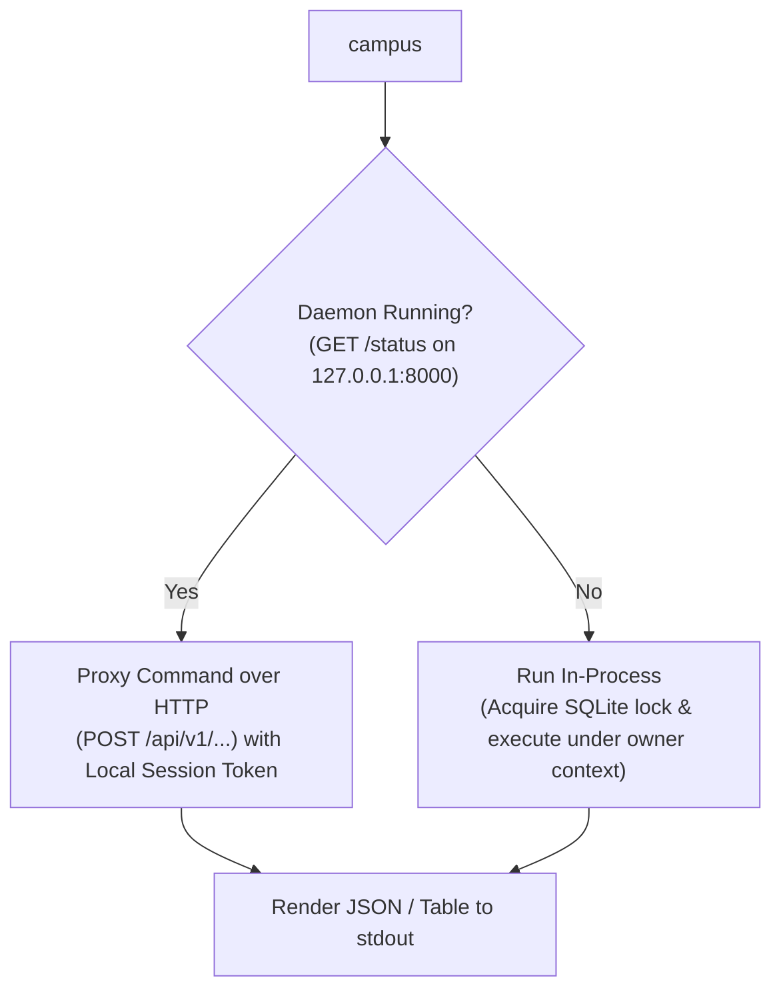

# Product scope and supported surfaces

> **Specification state.** Accepted; establishes runtime boundaries, supported client tiers (Web UI, CLI, MCP Server, KDE Integration), multi-profile single-tenant architecture, user lock screens, Role-Based Access Control (RBAC), platform packaging, and explicit non-goals.

| Field | Value |
|---|---|
| ID | F-001 |
| Status | Accepted |
| Owner | spiralsky |
| Created | 2026-10-27 |
| Last updated | 2026-10-28 |
| Target release | v1.0 |
| Related architecture | Local API Contract ([`F-015`](F-015-local-api-contract-security.md)), Brightspace Sync ([`F-004`](F-004-automatic-brightspace-sync.md)), Standalone Crawler ([`F-019`](F-019-brightspace-crawler.md)), LLM Provider & MCP ([`F-013`](F-013-llm-provider-privacy-mcp.md)) |
| Supersedes | — |
| Superseded by | — |

**Source key.** `owner` = confirmed by product owner; `baseline` = observed in current implementation; `proposal` = proposed specification.

---

## 1. Summary

`campus-assistant` is an offline-capable, privacy-preserving personal academic workstation and background daemon. It aggregates fragmented student communications, learning management system (LMS) coursework, and institutional emails into a unified local SQLite store, provides fast keyboard-driven triage and grounded task synthesis, and exposes a secure local surface to user interfaces and external AI agents.

This specification formally establishes:
1. **The Product Boundary:** A privacy-first local Linux daemon (with macOS/Windows portability for core CLI/API) bound strictly to loopback (`127.0.0.1`), requiring zero external cloud subscriptions or SaaS backend infrastructure.
2. **User Locking & Access Control:** Private student information (emails, grades, assignment submissions, course briefs) is locked behind a local user login screen with session management and Role-Based Access Control (RBAC). Architecture adopts a **multi-user/multi-profile capable single-tenant runtime**: the daemon supports separate local user profiles/roles (e.g. `owner`/`admin`, `student`/`user`, and limited-privilege `read_only`/`guest` or `agent`), keeping each user's credentials and records strictly compartmentalized or protected by local authentication.
3. **Surface Tiering:** Explicit classification of supported interfaces into **Tier 1 (First-Class / Core)**, **Tier 2 (Secondary / Platform-Specific)**, and **Explicit Non-Goals**.
4. **Packaging & Process Model:** A modular process architecture running as a `systemd --user` background daemon, companion CLI tools (`campus`), an embedded React Web App, and an MCP agent bridge.

---

## 2. Problem and context

The initial prototype of `campus-assistant` ran unauthenticated under the assumption that loopback isolation on a personal machine was sufficient. However:
* **Shared Physical Machines & Exposure:** In student residences, shared family workstations, campus lab computers, or when laptops are borrowed, leaving personal emails, transcripts, and assignment feedback openly visible to anyone opening `http://127.0.0.1:8000` is an unacceptable privacy hazard.
* **Granular Agent Privileges:** As external agents connect via MCP or local automation scripts, they should not automatically have unrestrained administrative authority (e.g. modifying institutional sync credentials or deleting data). They require distinct role permissions (e.g. `agent` role with task-read and study-plan-write permissions, but no credential read permissions).
* **Process Concurrency Clashes:** Background sync loops, ad-hoc CLI commands, and desktop UI scripts competed for SQLite write locks and Playwright browser profile directories.

`F-001` addresses this by formalizing an on-device authentication gate, local user role definitions, and strict client surface boundaries.

---

## 3. Product principles

1. **Local-First & Offline Capable:** The student's academic reality (deadlines, syllabus files, emails, rubrics) must remain accessible and queryable when offline.
2. **Authenticated Private Data Boundary:** Sensitive academic records and correspondence are locked behind a local authentication challenge (passphrase / PIN / WebAuthn biometric where available).
3. **Role-Based Access Control (RBAC):** Privileges are segmented by role (`admin`, `student`, `agent`, `guest`), allowing safe delegation of tools to external AI agents and read-only surfaces without compromising administrative credentials.
4. **Strict Loopback Binding:** The daemon never binds to public interfaces (`0.0.0.0`); all RPC and HTTP communication occurs on `127.0.0.1` / `::1`.
5. **Contract-Driven Decoupling:** All user surfaces (Web, CLI, KDE, MCP) consume the identical versioned REST contract (`/api/v1`) or MCP tool registry; no client is permitted to bypass the API to run ad-hoc SQLite mutations.
6. **Zero Cloud SaaS:** The application operates without reliance on any proprietary hosted cloud SaaS backend. User data lives on the user's hardware.

---

## 4. User authentication and Role-Based Access Control (RBAC)

### 4.1 Architecture Decision: Multi-Profile Single-Tenant Model

To satisfy locking private information behind a login screen while accommodating both personal usage and granular agent access:
* **The system implements a local multi-user/multi-profile capable model.**
* On initial setup, the user establishes the primary `owner` account with master passphrase/PIN and encryption keys.
* Secondary accounts/tokens can be created for specific roles (e.g. an automated `agent` token for Claude Desktop/Cursor with limited tool scope, or a `guest`/`read_only` profile for reviewing deadlines without viewing email contents).

### 4.2 Role Definitions

| Role | Scope & Permissions | Intended Consumer |
|---|---|---|
| **`owner` / `admin`** | Full administrative rights: configure LLM API keys, crawler credentials, manage users/tokens, trigger manual syncs, run DB backups, view all data. | Primary student (master passphrase login). |
| **`student`** | Read/write academic data: triage inbox, view course briefs, modify study plan milestones, view calendar. Cannot manage system credentials or delete accounts. | Primary student in daily locked session. |
| **`agent`** | Programmatic MCP and automation: access read-only task briefs, search course materials, create/modify study timelines. Zero access to raw email bodies, credentials, or system settings. | External AI tools (Claude Desktop, Antigravity, Cursor via MCP). |
| **`read_only` / `guest`** | Read-only access to calendar deadlines and upcoming tasks. Redacts email contents, private notes, and submission grades. | Secondary display widgets or calendar subscribers. |

### 4.3 Session Locking & Inactivity Timeout

- **Web UI Lock Screen:** Displays a PIN/passphrase challenge. Inactivity timeout (configurable, default 15 minutes) automatically locks the UI and revokes in-memory session tokens.
- **Local Secret Storage:** Session authentication tokens are signed locally using a cryptographic secret generated at first boot (`JWT` or signed bearer cookies stored in `HttpOnly` loopback cookies).

---

## 5. Client surfaces and support tiers

```mermaid
flowchart TD
    subgraph Core Platform Daemon
        Daemon["campus-assistant Daemon<br>(FastAPI /api/v1 + Background Runners)"]
        Store[("Local SQLite Store<br>(~/.local/share/campus-assistant)")]
        AuthGate["RBAC Auth Gate & Session Lock<br>(Owner, Student, Agent, Guest)"]
        Daemon --> AuthGate --> Store
    end

    subgraph Tier 1 Surfaces (First-Class & Primary)
        WebUI["Web UI<br>(React + Login/Lock Screen)"]
        CLI["CLI Tooling<br>(campus ...)"]
        MCPServer["MCP Server<br>(stdio & SSE with Agent Token)"]
    end

    subgraph Tier 2 Surfaces (Desktop Integrations)
        KDETray["KDE Tray Monitor<br>(PyQt / StatusNotifierItem)"]
        PlasmaWidget["KDE Plasma Widget<br>(QML Desktop Applet with Guest Token)"]
        ICSFeed["iCalendar Feed<br>(RFC 5545 /calendar.ics)"]
    end

    WebUI -- HTTP /api/v1 (Session Cookie) --> Daemon
    CLI -- HTTP /api/v1 or In-Process --> Daemon
    MCPServer -- Agent Token --> Daemon
    KDETray -- HTTP /api/v1 (Token) --> Daemon
    PlasmaWidget -- HTTP /api/v1 (Guest Token) --> Daemon
    ICSFeed -- HTTP GET /calendar.ics?token=... --> Daemon
```

### 5.1 Surface Support Matrix

| Surface | Tier | Runtime / Language | Communication Method | Support Guarantee |
|---|---|---|---|---|
| **Web Application** | **Tier 1** | TypeScript / React / Vite / Tailwind CSS | HTTP REST (`/api/v1`) | Primary full-featured UI for all platforms. Includes lock screen, login, triage review, task brief inspection, and system settings. |
| **Command Line Interface (`campus`)** | **Tier 1** | Python 3.14 (`argparse` / `httpx`) | REST (`/api/v1`) when daemon runs; direct store fallback when offline | Scriptable, headless, and terminal-native execution of all core commands (`sync`, `triage`, `briefs`, `eval`, `status`, `auth`). |
| **MCP Server (`campus mcp`)** | **Tier 1** | Python (MCP SDK / JSON-RPC) | `stdio` + Streamable HTTP (`/api/v1/mcp`) | First-class agentic bridge for Claude Desktop, Antigravity, Cursor, and IDE coding agents operating under `agent` role. |
| **Calendar Feed (`/calendar.ics`)** | **Tier 2** | Python (`icalendar` generator) | HTTP GET (`/calendar.ics`) | Standard RFC 5545 feed compatible with Thunderbird, KOrganizer, Google Calendar, Apple Calendar (protected by feed token). |
| **KDE Status Tray (`campus-kde`)** | **Tier 2** | Python (PyQt6 / PySide6) | HTTP REST (`/api/v1`) | System tray indicator showing unread/urgent count, status menu, and quick web launcher. |
| **KDE Plasma Widget** | **Tier 2** | QML / JavaScript | HTTP REST (`/api/v1`) | Read-only desktop companion widget displaying upcoming deadlines and triage review counts. |

---

## 6. Goals and non-goals

**Goals**
- **G-1 (Headless Parity):** Every core capability (ingestion, triage, task briefs, search, calendar export, evaluation) must be 100% operational in a headless Linux environment via CLI and REST API without a GUI.
- **G-2 (Client Equality & RBAC Enforcement):** Tier 1 and Tier 2 clients interact with the application via the stable `/api/v1` contract defined in [`F-015`](F-015-local-api-contract-security.md), verified through RBAC role scopes.
- **G-3 (Portable Storage Model):** Adhere to XDG Base Directory standards (`$XDG_DATA_HOME/campus-assistant`, `$XDG_CONFIG_HOME/campus-assistant`).
- **G-4 (Turnkey Packaging):** Provide both developer-friendly installation (`uv tool install .`) and a self-contained portable AppImage for Linux desktop distributions.

**Explicit Non-Goals**
- **NG-1 (Cloud SaaS Backend):** The application will not operate or synchronize through a hosted cloud backend. User data lives locally on the user's hardware.
- **NG-2 (Public Web Hosting):** The daemon is designed strictly for local-first execution. It is not intended to be exposed directly to the public internet without external reverse proxying / VPN isolation.
- **NG-3 (Mobile Native Applications):** There will be no native iOS or Android mobile applications in scope. Mobile access is achieved by accessing the local web interface over a private WireGuard / Tailscale VPN mesh.
- **NG-4 (Interactive Coursework Solver):** The application prepares task briefs, rubrics, and study schedules; it is NOT an automated coursework completion bot and does not take exams or write assignments.

---

## 7. Functional rules

| ID | Rule |
|---|---|
| **FR-001-01** | **Local Authentication Required:** The Web UI MUST present an authentication lock screen by default, requiring user unlock before displaying private emails, grades, or task briefs. |
| **FR-001-02** | **Role-Based Scopes:** Incoming requests MUST be validated against assigned RBAC roles (`owner`, `student`, `agent`, `guest`). Sensitive administrative endpoints (e.g. credential updates, user management) are restricted to `owner`. |
| **FR-001-03** | **Loopback Binding Guarantee:** The daemon HTTP server MUST bind exclusively to `127.0.0.1` and `::1`. Binding to `0.0.0.0` or external network interfaces is strictly forbidden by default. |
| **FR-001-04** | **Headless Runtime Guarantee:** The daemon, background runners, and CLI commands MUST execute cleanly without requiring an active X11 display, Wayland compositor, or audio subsystem. |
| **FR-001-05** | **API Exclusivity for UI:** Frontend surfaces (Web UI, KDE Tray, Plasma widget) MUST communicate with the application state solely via `/api/v1` REST endpoints or MCP. Direct access to SQLite database files from UI clients is prohibited. |
| **FR-001-06** | **Daemon Coordination:** When `campus serve` is active in the background, ad-hoc CLI commands (such as `campus sync` or `campus analyze`) MUST delegate operations via HTTP to the running daemon rather than competing for SQLite locks or crawler browser sessions. |
| **FR-001-07** | **XDG Directory Compliance:** Data files, configuration, and caches MUST follow standard XDG directories: <br>- Data: `$XDG_DATA_HOME/campus-assistant` (default `~/.local/share/campus-assistant`) <br>- Config: `$XDG_CONFIG_HOME/campus-assistant` (default `~/.config/campus-assistant`) <br>- Cache: `$XDG_CACHE_HOME/campus-assistant` (default `~/.cache/campus-assistant`) |
| **FR-001-08** | **Graceful Desktop Client Degradation:** Failure or absence of desktop environment components (e.g. Qt libraries, D-Bus notification daemon, or KDE Plasma) MUST NOT impact daemon operation or web client availability. |

---

## 8. Process model and operations

### 8.1 Background Service Lifecycle

The primary continuous runtime for `campus-assistant` on Linux is a `systemd --user` service:

```ini
# ~/.config/systemd/user/campus-assistant.service
[Unit]
Description=Campus Assistant Daemon
After=network.target

[Service]
Type=simple
ExecStart=%h/.local/bin/campus serve
Restart=always
RestartSec=10
Environment=PYTHONUNBUFFERED=1

[Install]
WantedBy=default.target
```

### 8.2 CLI Dispatching Model



---

## 9. Edge cases and failure modes

_Scaffold: to be completed. No entries yet — this section is reserved for owner-authored edge cases (for example lock-screen bypass, token expiry during a session, desktop component absence, and concurrent CLI/daemon access)._

## 10. Supported target environments

| Operating System | Architecture | Support Status | Notes |
|---|---|---|---|
| **Linux (systemd)** | `x86_64`, `aarch64` | **Tier 1 (Target / Native)** | Ubuntu 22.04+, Fedora 38+, Arch Linux, Debian 12+. Full systemd service, Web UI, CLI, and KDE components. |
| **Linux (Headless / Container)** | `x86_64`, `aarch64` | **Tier 1 (Headless Core)** | Full daemon, CLI, and Web UI. KDE desktop components disabled. |
| **macOS** | `Apple Silicon (arm64)`, `Intel (x64)` | **Tier 2 (Supported Core)** | Daemon, CLI, Web UI, and launchd service support. KDE tray/widget unavailable. |
| **Windows (WSL2)** | `x86_64` | **Tier 2 (Supported Core)** | Runs seamlessly via WSL2 Ubuntu. |

---

## 11. Non-functional requirements

| Area | Requirement |
|---|---|
| **Memory Footprint** | Background daemon idle RSS: < 90 MB Python memory. |
| **Startup Latency** | Web server ready to accept HTTP connections in < 1.2s from cold start. |
| **Security Isolation** | Loopback transport only. Local authentication challenge, Host/Origin header validation on all HTTP requests ([`F-015`](F-015-local-api-contract-security.md)). |
| **Zero Cloud SaaS Telemetry** | No product analytics, telemetry pings, crash reporting, or phone-home requests are embedded in any client surface. |

---

## 12. Acceptance criteria

| ID | Given | When | Then | Test level |
|---|---|---|---|---|
| **AC-001-01** | Daemon starts on a headless machine without `$DISPLAY` or Wayland. | Server initializes on `127.0.0.1:8000`. | All endpoints respond, Web UI is accessible, and zero Qt/display errors are emitted. | Integration |
| **AC-001-02** | User accesses Web UI without an active session. | Navigates to `/` or any academic route. | UI displays authentication lock screen; access to messages/grades is blocked. | Integration / E2E |
| **AC-001-03** | An external MCP client attempts tool invocation using an `agent` role token. | Calls `get_task_brief`. | Operation succeeds; if agent calls admin endpoint `PUT /settings/llm/keys`, access is denied with 403 Forbidden. | Security / Integration |
| **AC-001-04** | `campus serve` is running in background. | User executes `campus sync` in terminal. | CLI detects active server, proxies request via `/api/v1/sync/run`, and prints server response. | Integration |

---

## 13. Compatibility and migration

_Scaffold: to be completed. No entries yet — this section is reserved for how the authentication/RBAC model and surface tiering change the current unauthenticated loopback behaviour._

## 14. Open questions and decisions

_Scaffold: to be completed. No entries yet._

## 15. Change log

| Date | Change | By |
|---|---|---|
| 2026-10-27 | Initial comprehensive specification draft for F-001. | spiralsky |
| 2026-10-27 | Updated to incorporate local multi-user/multi-profile architecture, lock screen, and RBAC roles (`owner`, `student`, `agent`, `guest`). | spiralsky |
| 2026-10-28 | Corpus hygiene: invalid status `Completed` normalised to `Accepted`; empty scaffolds added for edge cases, compatibility/migration and open questions. No behavioural change. | agent |
