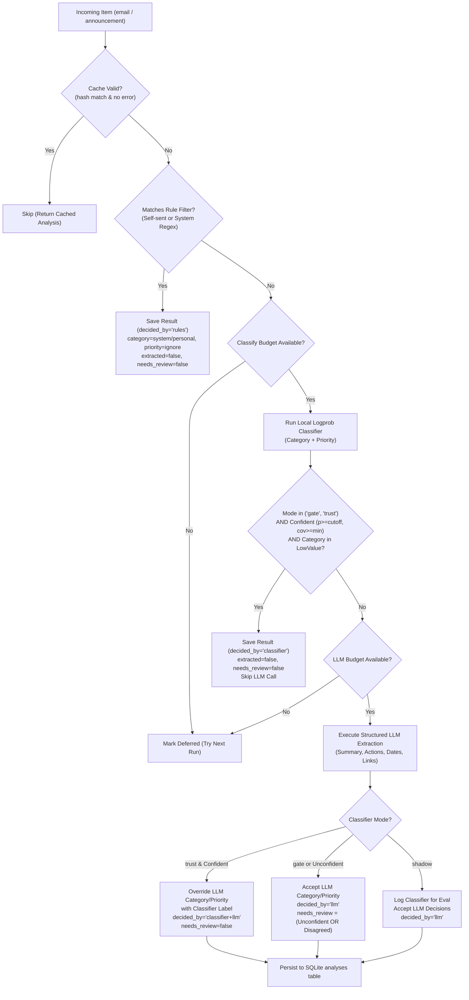

# Triage cascade and review workflow

> **Specification state.** Draft establishing the multi-tiered triage pipeline (Rules → Logprob Classifier → LLM Structured Extraction), execution budgeting, confidence cutoffs, user review queues, and calibration feedback loops.

| Field | Value |
|---|---|
| ID | F-006 |
| Status | Draft |
| Owner | spiralsky |
| Created | 2026-10-27 |
| Last updated | 2026-10-27 |
| Target release | v1.0 |
| Related architecture | Canonical Item Taxonomy ([`F-002`](F-002-canonical-item-taxonomy.md)), Change Tracking ([`F-003`](F-003-change-tracking-history.md)), Local API Contract ([`F-015`](F-015-local-api-contract-security.md)), LLM Provider Configuration (`F-013`) |
| Supersedes | — |
| Superseded by | — |

**Source key.** `owner` = confirmed by product owner; `baseline` = observed in current implementation; `proposal` = proposed specification.

---

## 1. Summary

The triage cascade is the decision-making engine in `campus-assistant` that categorizes incoming messages (emails and academic announcements), assigns urgency priorities, extracts structured actionable entities (action items with due dates, events, opportunities, and links), and routes ambiguous cases to an interactive review queue.

To maintain privacy, near-instant local responsiveness, and low resource overhead on student hardware without saturating local GPUs or racking up commercial cloud API costs, triage operates as a strict three-tier cascade:
1. **Rule Heuristics:** Zero-cost deterministic filtering (self-sent emails, automated system receipts, and platform pings).
2. **Logprob Classifier (Local):** Single-token letter logprob evaluation with KV-cache reuse, renormalised probabilities, and coverage metrics over neutral options. Confident low-value items (newsletters, system spam) are gated and short-circuited here.
3. **Structured LLM Extraction:** High-order reasoning extracting concise summaries, deadlines, and action checklists, invoked only for meaningful messages or when classification confidence falls below calibrated cutoffs.

The system features a keyboard-accelerated review queue (`Inbox.tsx`) and an empirical calibration engine (`campus eval`) that validates classifier confidence against human labels before trusting autonomous decisions.

---

## 2. Problem and context

Students are bombarded with hundreds of campus communications weekly across institutional email accounts, LMS course announcements, clubs, and automated portal pings. Manually sorting through these creates cognitive overload and causes missed deadlines, overlooked academic forms, or lost bursary/scholarship opportunities.

Existing triage approaches suffer from critical flaws:
* **Rule-only filters:** Too brittle. Institutional senders broadcast everything from critical exam room rescheduling to spammy student union surveys from the same email address.
* **Pure LLM processing:** Extremely resource-intensive. Processing every bulk newsletter and confirmation receipt through a large generative model causes battery drain on laptops, long ingestion backlogs, and privacy concerns if sending personal emails to third-party cloud APIs.
* **Uncalibrated classifiers:** Instruct-tuned LLMs produce heavily overconfident softmax scores (often clustering near 0.99 even when completely hallucinating). Trusting them blindly without empirical human ground-truth calibration leads to silent failures.

`F-006` formalizes the tiered triage cascade, explicit execution budgets, reproducible input caching, and the human-in-the-loop review workflow.

---

## 3. Users and jobs

| User | Job / need | Notes |
|---|---|---|
| Student | Triaging inbox in under 60 seconds without missing critical deadlines or mandatory forms. | Needs immediate visual distinction between urgent action items and disposable notices. |
| Student | Rapidly correcting or confirming automated classifications via keyboard. | Needs 1-key actions (`1`–`8` category, `q`/`w`/`e`/`r` priority, `Enter` accept) that automatically advance. |
| Developer / Power User | Calibrating local model confidence thresholds against actual personal labels. | Uses `campus eval` to measure whether `p >= cutoff` achieves required precision before turning on full trust. |

---

## 4. Goals and non-goals

**Goals**
- **G-1 (Tiered Efficiency):** Process trivial emails in <1ms via rules, dismiss bulk spam in <50ms via local logprobs, reserving expensive full-text LLM extraction only for messages requiring action or deep understanding.
- **G-2 (Determinism & Invalidation):** Hash input contents and prompt versions (`_hash(content_hash, 'triage', prompt_version)`). Never re-analyze an item unless its content or prompt schema changes.
- **G-3 (Resource Protection):** Enforce strict per-run throughput caps (`MAX_CLASSIFY_PER_RUN`, `MAX_LLM_PER_RUN`) so ingestion never locks up local GPU/CPU compute or starves interactive requests.
- **G-4 (Calibrated Trust Modes):** Support three explicit operating modes (`shadow`, `gate`, `trust`) that separate model suggestions from autonomous overrides until empirically verified.
- **G-5 (Fast Review & Feedback Loop):** Store every user adjustment as a verified dual-label tuple `(category, priority)` in `labels`, providing continuous ground-truth test sets.

**Non-goals**
- **NG-1 (Automated Outbound Action):** Triage never automatically sends emails, registers for courses, submits assignments, or clicks links on the user's behalf.
- **NG-2 (Real-time Streaming Classification):** Classification runs asynchronously in background batches during ingestion or on-demand sync; it does not block mailbox synchronization.
- **NG-3 (General Web Article Summarization):** Triage is specialized strictly for campus correspondence and announcements; arbitrary web browsing summarization is handled separately.

---

## 5. Current behaviour (baseline)

The existing implementation in `src/campus_assistant/analysis/pipeline.py` and `web/src/pages/Inbox.tsx` implements the core cascade:
- `triage_rule()` catches self-sent emails (`my_addresses`) and known automated sender domains (`SYSTEM_SENDERS`).
- `LogprobClassifier` (`src/campus_assistant/llm/classify.py`) queries a local llama-server using single-token logprobs over neutral letter prompts (`A`, `B`, `C`...), tracking probability $p$ and option coverage.
- Structured LLM triage uses Pydantic schema validation (`MessageTriage`) via Claude or llama.cpp structured outputs.
- Backlog processing is sequential and capped via `CAMPUS_ANALYZE_MAX_CLASSIFY` (default 60) and `CAMPUS_ANALYZE_MAX_LLM` (default 15).
- Web frontend has a dedicated "Review queue" toggle filtering items where `needs_review = true` or `corrected = false`.

**Identified gaps in baseline:**
- Cutoffs and modes are set purely via environment variables (`CAMPUS_CLASSIFIER_MODE`, `CAMPUS_CLASSIFY_CUTOFF`), with no UI controls or settings configuration schema.
- Re-analysis cache invalidation does not automatically cascade when the user overrides a triage label, leading to potential inconsistency between `labels` and `analyses.result`.
- Missing structured persistence for user notes attached during review.
- System sender patterns are hardcoded in Python regex rather than configurable per user/institution.

---

## 6. Desired behaviour

### 6.1 Cascade Execution Lifecycle



### 6.2 Review Workflow & UI States

1. **Inbox View:** Displays all triaged items with category badges, priority colors, source indicators, and relative arrival times.
2. **Review Queue Filter:** Toggling `Review queue` filters the view strictly to items requiring human verification:
   - Any item where `needs_review = true` (model confidence was below threshold, or Classifier and LLM had conflicting category assessments).
   - Any item unconfirmed by the user (`labels` row absent).
3. **Keyboard-Driven Triage:**
   - `j` / `k` (or `Down` / `Up`): Navigate row by row.
   - `1` through `8`: Re-label Category (1: Action Required, 2: Deadline, 3: Notice, 4: Opportunity, 5: Personal, 6: System, 7: Newsletter, 8: Other).
   - `q` / `w` / `e` / `r`: Assign Priority (q: Urgent, w: Soon, e: Whenever, r: Ignore). Instantly saves and advances to the next row.
   - `Enter`: Accepts the model's suggested category and priority as correct, saves to `labels`, and advances to the next item.

### 6.3 Evaluation & Confidence Calibration (`campus eval`)

- Evaluates stored analyses against ground-truth user labels in `labels`.
- Buckets classifier confidence scores into intervals (`0.00-0.50`, `0.50-0.70`, `0.70-0.80`, `0.80-0.90`, `0.90-0.95`, `0.95-0.99`, `0.99-1.00`).
- Reports empirical precision:
  $$\text{Accuracy}_{\ge \text{cutoff}} = \frac{\text{Correct calls with } p \ge \text{cutoff}}{\text{Total calls with } p \ge \text{cutoff}}$$
- Alerts the user if enabling `trust` mode is statistically safe (e.g. accuracy $\ge 95\%$) or dangerous on their distribution.

---

## 7. Functional rules

| ID | Rule |
|---|---|
| **FR-006-01** | **Target Kinds:** Triage cascade applies strictly to items of kind `email` and `announcement`. Other kinds (`assignment`, `quiz`, `grade`, `content`) bypass triage. |
| **FR-006-02** | **Input Caching:** Every triage result is stored with input hash $H = \text{SHA256}(\text{content\_hash} \parallel \text{"triage"} \parallel \text{PROMPT\_VERSION})$. Re-analysis is skipped unless forced, input hash changes, or previous run logged an unrecovered error. |
| **FR-006-03** | **Heuristic Rule Precedence:** Emails where sender address matches user's configured addresses MUST resolve immediately to `category: "personal"`, `priority: "ignore"`, `decided_by: "rules"`, bypassing models. |
| **FR-006-04** | **System Sender Pattern:** Emails matching configurable system sender patterns MUST resolve to `category: "system"`, `priority: "ignore"`, `decided_by: "rules"`, bypassing models. |
| **FR-006-05** | **Neutral Letter Prompts:** Classifier options MUST be presented to local models using randomized or neutral letter labels (`A`, `B`, `C`...) rather than semantic words to avoid token bias. |
| **FR-006-06** | **Confidence Gate:** A classification decision is considered "confident" if and only if winning option probability $p \ge \text{CLASSIFY\_CUTOFF}$ (default 0.80) AND valid token mass $\text{coverage} \ge \text{MIN\_COVERAGE}$ (default 0.50). |
| **FR-006-07** | **Low-Value Short-Circuit:** In `gate` and `trust` modes, confident predictions for `newsletter`, `system`, or `priority="ignore"` MUST skip the LLM extraction step, saving zeroed action lists and `extracted=false`. |
| **FR-006-08** | **Disagreement Review Flag:** When structured LLM is invoked, if classifier and LLM select different categories, or classifier confidence was below cutoff, `needs_review` MUST be set to `true`. |
| **FR-006-09** | **Execution Batch Budgets:** Background triage runs MUST respect configurable caps (`MAX_CLASSIFY_PER_RUN`, `MAX_LLM_PER_RUN`). Items exceeding the budget are deferred to subsequent sync runs without logging failure errors. |
| **FR-006-10** | **Human Label Immutability:** User manual selections via UI/CLI write directly to `labels` table. User labels supersede all model decisions in downstream UI views, tasks, and notification feeds. |
| **FR-006-11** | **Full Label Tuples:** Every user label interaction MUST save both `category` and `priority` simultaneously so that every record serves as a complete training example for evaluation. |
| **FR-006-12** | **Singular Action Deadlines:** Action item `due` field MUST represent the explicit deadline stated in the message text, formatted as ISO 8601 UTC. It must NEVER default to current ingestion timestamp. |

---

## 8. Data and contracts

### 8.1 Entities and Schemas

#### Analysis Result Schema (`analyses.result`)

```json
{
  "category": "action_required",
  "priority": "urgent",
  "summary": "Submit graduation declaration by Friday 5 PM.",
  "actions": [
    {
      "what": "Submit graduation declaration form",
      "due": "2026-10-30T09:00:00Z"
    }
  ],
  "dates": [
    {
      "what": "Declaration deadline",
      "when": "2026-10-30T09:00:00Z",
      "kind": "deadline"
    }
  ],
  "opportunity": null,
  "links": [
    {
      "label": "Declaration Portal",
      "url": "https://portal.institution.edu/grad"
    }
  ],
  "classification": {
    "category": {
      "label": "action_required",
      "p": 0.9421,
      "coverage": 0.8812,
      "probs": {
        "action_required": 0.9421,
        "notice": 0.0412,
        "other": 0.0167
      },
      "permutations": 1
    },
    "priority": {
      "label": "urgent",
      "p": 0.8914,
      "coverage": 0.9120,
      "probs": {
        "urgent": 0.8914,
        "soon": 0.1012,
        "whenever": 0.0074
      },
      "permutations": 1
    }
  },
  "decided_by": "llm",
  "needs_review": false,
  "extracted": true
}
```

#### Taxonomy Types

```typescript
export type Category =
  | 'action_required' // Official: student must act (form, payment, reply, attendance)
  | 'deadline'        // Dates or schedule changes (exams, submissions, timetables)
  | 'notice'          // Official information with nothing to do
  | 'opportunity'     // Optional events, internships, jobs, scholarships, clubs
  | 'personal'        // Real person writing directly to the student
  | 'system'          // Machine notifications (OTPs, LMS activity receipts)
  | 'newsletter'      // Digests, marketing, campus club bulk flyers
  | 'other';

export type Priority = 'urgent' | 'soon' | 'whenever' | 'ignore';

export type ClassifierMode = 'shadow' | 'gate' | 'trust';
```

### 8.2 Database Tables

```sql
-- Analysis cache
CREATE TABLE IF NOT EXISTS analyses (
  item_id TEXT NOT NULL,
  task TEXT NOT NULL,                -- 'triage' or 'brief'
  input_hash TEXT NOT NULL,
  provider TEXT NOT NULL,            -- 'rules', 'llama.cpp', 'claude', etc.
  model TEXT,
  result TEXT,                       -- JSON payload conforming to MessageTriage
  error TEXT,
  usage TEXT,                        -- JSON {"in": tokens, "out": tokens}
  created_at TEXT NOT NULL,
  PRIMARY KEY (item_id, task),
  FOREIGN KEY (item_id) REFERENCES items(id) ON DELETE CASCADE
);

-- Human ground truth labels
CREATE TABLE IF NOT EXISTS labels (
  item_id TEXT NOT NULL PRIMARY KEY,
  category TEXT NOT NULL,
  priority TEXT NOT NULL,
  note TEXT,
  created_at TEXT NOT NULL,
  updated_at TEXT NOT NULL,
  FOREIGN KEY (item_id) REFERENCES items(id) ON DELETE CASCADE
);
```

### 8.3 REST API Endpoints

| Method | Endpoint | Request Payload | Response Envelope | Description |
|---|---|---|---|---|
| `GET` | `/api/v1/triage` | Query params: `days`, `categories`, `priorities`, `kinds`, `needs_review`, `include_ignored` | `{ "data": [ TriageRow... ] }` | Lists inbox items combined with latest analysis and user label overrides. |
| `POST` | `/api/v1/triage/run` | `{ "since_days": 30, "force": false, "capped": true }` | `{ "data": { "counts": { ... } } }` | Manually triggers triage batch execution. |
| `PUT` | `/api/v1/labels/{item_id}` | `{ "category": "action_required", "priority": "urgent", "note": "optional" }` | `{ "data": { "item_id": "...", "status": "saved" } }` | Records or updates human label. |
| `GET` | `/api/v1/triage/eval` | Query params: `cutoff` (default `0.8`) | `{ "data": EvalReport }` | Evaluates accuracy and calibration of classifier against labeled items. |

---

## 9. Edge cases and failure modes

| Case | Expected Behaviour |
|---|---|
| **Local LLM Server Down** | Classifier errors are caught, item marked with `error`, and triage run continues. Backlog is retried automatically on next run without crashing daemon. |
| **Cloud API Rate Limit / Quota** | Caught as `LLMError`, error stored in analysis row, `counts["errors"]` incremented. System pauses cloud calls for that batch to preserve quota. |
| **Model Content Refusal** | If an LLM refuses processing (e.g. false flag safety trigger), recorded as `LLMRefused`. Item flagged for manual review with `needs_review=true`. |
| **Extremely Long Messages** | Body text is truncated to fit within `max_input_chars` budget minus header overhead (`tidy_urls` applied first; truncation marker appended). |
| **Malformed Structured JSON** | If model output fails Pydantic validation, pipeline logs warning, stores parse error in `analyses.error`, and defers item to review queue. |
| **Deleted Source Item** | Foreign key cascade in SQLite cleans up associated `analyses` and `labels` rows immediately upon item deletion. |

---

## 10. UX and keyboard accessibility

- **List Navigation:** `j` / `Down` and `k` / `Up` shift active cursor without reloading page state.
- **One-Key Categorization:** Numerical keys `1`–`8` immediately select category.
- **Auto-Advancing Priority:** Shortcut keys `q` (urgent), `w` (soon), `e` (whenever), and `r` (ignore) assign priority and automatically jump cursor to the next message.
- **Confirmation:** Pressing `Enter` accepts current suggestions as ground-truth label and moves down.
- **High-Contrast Indicators:**
  - Solid background on active category/priority buttons.
  - Dashed outline on model-recommended buttons.
  - Probability badge displayed on hover/focus (e.g. `0.94`).
- **Focus Preservation:** When navigating rows, focused item scrolls into view with `block: 'nearest'`.

---

## 11. Non-functional requirements

| Area | Requirement |
|---|---|
| **Latency** | Heuristic rules: < 1ms. Local logprob classification: < 150ms per item. Full structured LLM extraction: < 2.5s per item. |
| **Privacy & Zero-Leakage** | In default local mode, zero email text leaves `localhost`. Senders, subject lines, and student identifiers are processed strictly on-device. |
| **Local Compute Safety** | Concurrency locked to single-threaded sequential calls (`asyncio.Semaphore(1)`) or max 2 for GPU servers, preventing desktop freezes. |
| **Storage Footprint** | Analysis JSON payloads are compact (< 2 KB per item). Stored in SQLite with write-ahead logging (WAL). |

---

## 12. Compatibility and migration

- **Breaking Changes:** No breaking storage changes. Backward-compatible with existing `items`, `analyses`, and `labels` tables.
- **Schema Evolution:** Introduction of `PROMPT_VERSION["triage"] = 4`. Modifying prompt versions automatically causes subsequent runs to cleanly re-analyze items without manual DB wipes.
- **Rollback:** Setting `CAMPUS_CLASSIFIER_MODE=shadow` safely disables classifier overrides while maintaining complete logging.

---

## 13. Acceptance criteria

| ID | Given | When | Then | Test level |
|---|---|---|---|---|
| **AC-006-01** | An email sent from the student's own registered address. | Triage pipeline executes. | `triage_rule` assigns `category="personal"`, `priority="ignore"`, `decided_by="rules"` without calling any model. | Unit |
| **AC-006-02** | An item whose `content_hash` and `PROMPT_VERSION` match stored analysis. | Triage pipeline runs without `force=true`. | Item is skipped and existing cached analysis is retained. | Unit |
| **AC-006-03** | Local classifier returns $p = 0.95$ and coverage $0.85$ for `category="newsletter"` in `gate` mode. | Triage processes the message. | Item is saved with `decided_by="classifier"`, `extracted=false`, and LLM extraction is skipped. | Integration |
| **AC-006-04** | Classifier predicts `action_required` while LLM predicts `notice`. | Structured extraction finishes in `gate` mode. | Result is saved with `needs_review=true` and `decided_by="llm"`. | Integration |
| **AC-006-05** | User presses `q` on an item in the Inbox UI. | Event handler fires. | Mutation `PUT /api/v1/labels/{id}` is submitted with `priority="urgent"` and selection advances to next row. | E2E / Component |
| **AC-006-06** | 50 labelled items exist in the database. | `campus eval --cutoff 0.85` or `GET /api/v1/triage/eval` is invoked. | System returns accuracy metrics broken down by confidence bucket and cutoff precision. | Integration |

---

## 14. Test plan

- **Unit Tests (`tests/test_classify.py`, `tests/test_analysis.py`):**
  - Verify deterministic rule matching for self-sent and LMS system senders.
  - Verify input hash computation and prompt version change detection.
  - Test logprob renormalisation over neutral letters with simulated token logprob dictionaries.
- **Integration Tests (`tests/test_service.py`):**
  - Run full cascade end-to-end with mock LocalProvider and ClaudeProvider.
  - Verify budget enforcement (`MAX_CLASSIFY_PER_RUN`, `MAX_LLM_PER_RUN`).
- **Frontend Component Tests (`web/src/pages/Inbox.test.tsx`):**
  - Verify keyboard event dispatching (`j`/`k`, `1`–`8`, `q`/`w`/`e`/`r`, `Enter`).
  - Verify review queue toggle correctly filters rows.

---

## 15. Open questions and decisions

| ID | Question | Owner | Resolution | Date |
|---|---|---|---|---|
| **Q-006-01** | Should system sender patterns be configured in database metadata rather than source code regex? | spiralsky | Yes: move default regex to `meta` table key `config:system_senders` editable via Settings UI. | 2026-10-27 |
| **Q-006-02** | Should manual user labels invalidate existing `analyses` cache or remain a purely separate presentation overlay? | spiralsky | Separate presentation overlay: `labels` record acts as permanent ground-truth override without erasing original model predictions. | 2026-10-27 |
| **Q-006-03** | What is the minimum recommended label count before switching `CAMPUS_CLASSIFIER_MODE` from `gate` to `trust`? | spiralsky | At least 100 verified items with `classifier_accuracy_above_cutoff >= 0.95`. | 2026-10-27 |

---

## 16. Out of scope / future work

- Active continuous on-device fine-tuning (LoRA / SetFit) of the classifier from user labels.
- Multi-user label consensus or cloud synchronization.
- Auto-drafting reply templates for emails flagged with `action_required`.

---

## 17. Change log

| Date | Change | By |
|---|---|---|
| 2026-10-27 | Initial comprehensive specification draft for F-006. | spiralsky |
