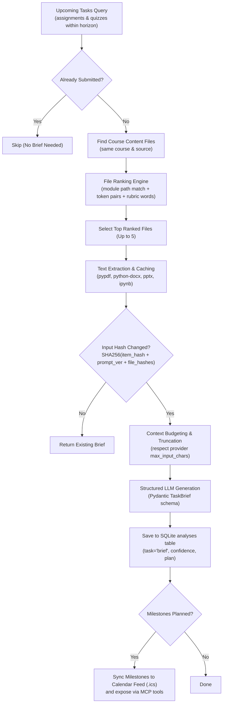
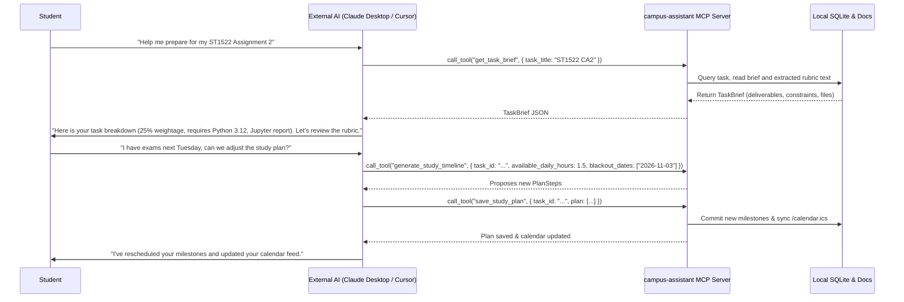

# Task briefs and study planning

> **Specification state.** Draft establishing multi-file academic task briefs, context document ranking, LLM rubric parsing, study timeline generation, confidence evaluation, calendar milestone sync, and interactive planning via MCP.

| Field | Value |
|---|---|
| ID | F-007 |
| Status | Draft |
| Owner | spiralsky |
| Created | 2026-10-27 |
| Last updated | 2026-10-27 |
| Target release | v1.0 |
| Related architecture | Canonical Item Taxonomy ([`F-002`](F-002-canonical-item-taxonomy.md)), Change Tracking ([`F-003`](F-003-change-tracking-history.md)), LLM Provider & MCP ([`F-013`](F-013-llm-provider-privacy-mcp.md)), Local API Contract ([`F-015`](F-015-local-api-contract-security.md)), Task & Deadline Views (`F-010`) |
| Supersedes | — |
| Superseded by | — |

**Source key.** `owner` = confirmed by product owner; `baseline` = observed in current implementation; `proposal` = proposed specification.

---

## 1. Summary

This specification governs the automated synthesis of actionable task briefs and structured study timelines for upcoming academic deadlines (assignments, quizzes, projects, and lab submissions) across all enrolled courses.

Instead of requiring students to manually hunt through lecture folders, download scattered syllabus PDFs, and piece together fragmented marking rubrics, `campus-assistant`:
1. **Discovers and Ranks Relevant Material:** Deterministically searches and scores course files (PDFs, Word docs, PowerPoint presentations, Jupyter notebooks) using module tree proximity, task title tokens, and rubric keywords.
2. **Extracts Plain Text with Caching:** Parses heterogeneous documents (`.pdf`, `.docx`, `.pptx`, `.ipynb`, `.html`) with incremental disk caching (`.txt-extract`).
3. **Generates Structured Briefs:** Prompts an LLM (Claude, Gemini, or local models) using strict Pydantic schemas (`TaskBrief`) to extract deliverable lists, technical constraints, grading weightages, submission venues, confidence scores, and open questions.
4. **Builds Actionable Study Plans:** Synthesizes realistic 3–8 step study timelines with target completion dates and estimated hours, leaving a buffer before the hard deadline.
5. **Syncs to Calendar & Exposes via MCP:** Commits milestone steps into student calendar feeds (`.ics`) and exposes a programmatic surface for external AI agents (via the Model Context Protocol tools defined in [`F-013`](F-013-llm-provider-privacy-mcp.md)) to inspect, refine, or regenerate study plans interactively.

---

## 2. Problem and context

In modern higher education, a single course assignment is rarely self-contained within the LMS assignment submission box. The submission portal often contains only a terse one-liner (e.g. *"Upload your CA2 report here"*), while the actual instructions are scattered across:
* A 15-page project specification PDF located in a lecture module folder.
* A grading rubric embedded in a Word `.docx` table.
* Dataset links and starter code inside a `.ipynb` notebook.
* Lecturer clarifications posted in separate course announcements.

Students frequently miss key deliverables (e.g. forgetting to include an executive summary or dataset appendix), fail to observe formatting limits, or leave multi-week projects until the night before because they lack a decomposed study timeline.

`F-007` formalizes the end-to-end task analysis pipeline: identifying candidate tasks, matching and ranking related course content files, managing token context budgets, synthesizing briefs with confidence ratings, and syncing milestones to user calendars.

---

## 3. Users and jobs

| User | Job / need | Notes |
|---|---|---|
| Student | Understand what an assignment requires in under 30 seconds without reading 20 pages of course documentation. | Needs a consolidated summary: deliverables, requirements/constraints, weightage, and submission instructions. |
| Student | Break down a major multi-week deadline into manageable milestone steps with target dates. | Needs a realistic study plan spaced between today and the deadline with estimated effort. |
| Student | Identify ambiguities early so they can ask the lecturer before the deadline rush. | Needs an explicit "Open questions" list highlighting missing criteria or conflicting directions. |
| External Agent (Claude / Cursor / Antigravity) | Retrieve complete academic context to help the student code, write, or study. | Interacts via MCP tools (`get_task_brief`, `generate_study_timeline`, `save_study_plan`). |

---

## 4. Goals and non-goals

**Goals**
- **G-1 (Automated Document Matching):** Rank course documents based on structural module folder hierarchy, title token pairs, and rubric keywords, identifying the genuine task brief without manual user tagging.
- **G-2 (Heterogeneous File Ingestion):** Support plain text extraction from PDF, DOCX, PPTX, IPYNB, and HTML with cached `.txt-extract` files to avoid redundant CPU-heavy parsing.
- **G-3 (Structured & Grounded Extraction):** Generate structured briefs strictly grounded in provided texts; explicitly forbid hallucinating constraints; set confidence to `low` when brief documents are absent.
- **G-4 (Actionable Study Timelines):** Decompose tasks into 3–8 chronological milestones with concrete target dates (`ISO 8601`) and hour estimates, leaving a 24–48 hour buffer before due dates.
- **G-5 (Interactive Agentic Surface via MCP):** Support on-demand inspection, modification, and regeneration of study timelines via the MCP server defined in [`F-013`](F-013-llm-provider-privacy-mcp.md).
- **G-6 (Calendar Synchronization):** Automatically export generated study milestones as calendar events with alarms in the local iCalendar (`.ics`) feed.

**Non-goals**
- **NG-1 (Automated Submission):** The system never uploads files, submits code, or takes quizzes on behalf of the student.
- **NG-2 (Plagiarism Checking):** The system does not compare student work against turnitin/plagiarism databases.
- **NG-3 (Real-Time Document Editing):** The system provides briefs and study timelines; it does not replace word processors or code editors.

---

## 5. Pipeline architecture



---

## 6. Functional rules

### 6.1 Task Candidate Selection & Filtering

| ID | Rule |
|---|---|
| **FR-007-01** | **Eligible Kinds:** Brief analysis candidates MUST belong to kinds `assignment`, `quiz`, or `project`. Messages, emails, and general announcements are excluded. |
| **FR-007-02** | **Submission Exclusion:** Tasks where `data.submitted == true` MUST be excluded from automated analysis queues to avoid wasting compute on completed work. |
| **FR-007-03** | **Time Horizon:** Default analysis horizon is 60 days ahead (`horizon_days = 60`). Tasks past their due date or beyond the horizon are excluded unless explicitly requested via API or MCP. |
| **FR-007-04** | **Input Caching:** Every brief result MUST be stored with an input hash: <br>$$H = \text{SHA256}\left(\text{content\_hash} \parallel \text{"brief"} \parallel \text{PROMPT\_VERSION} \parallel \sum \text{file\_sha256}\right)$$ <br>If $H$ matches stored analysis and no previous error was recorded, analysis MUST be skipped. |

### 6.2 File Matching and Ranking Algorithm

| ID | Rule |
|---|---|
| **FR-007-05** | **Candidate File Pool:** File candidates are drawn from items of kind `content` sharing the exact same `source` and `course_id` as the task. |
| **FR-007-06** | **Anchor Module Proximity:** If the course content contains a direct `Link` item whose title matches the task title, that link's `module_path` is designated an **Anchor Path**. Files sharing the same module prefix receive a $+15$ point boost. |
| **FR-007-07** | **Token Pair Matching:** Consecutive word-number tokens in task title (e.g. `Assignment 1` $\rightarrow$ `("assignment", "1")`) matching the file name or path receive a $+10$ point boost. |
| **FR-007-08** | **Keyword & Rubric Scoring:** Unigram overlap with task title adds $+2$ per matching token. Files containing brief/spec keywords (`brief`, `spec`, `rubric`, `requirement`, `guideline`, `criteria`, `marking`, `ca1`, `ca2`) receive an additional $+3$ boost. |
| **FR-007-09** | **Top Candidate Limit:** The top 5 scored files are selected for text extraction. Files scoring 0 are discarded. |

### 6.3 Document Text Extraction & Budgeting

| ID | Rule |
|---|---|
| **FR-007-10** | **Extractor Formats:** Supported formats for text extraction: <br>- `.pdf`: Page-by-page text extraction (`pypdf`). <br>- `.docx`: Paragraphs and table cell extraction (`python-docx`). <br>- `.pptx`: Slide text frames (`python-pptx`). <br>- `.ipynb`: JSON source cell concatenation. <br>- `.html` / `.htm`: DOM-to-clean-text extraction (`html_to_text`). <br>- `.txt`, `.md`, `.csv`, `.py`, `.rtf`: Direct UTF-8 text read. |
| **FR-007-11** | **Incremental Disk Cache:** Extracted text MUST be cached on disk alongside the file as `<filename>.txt-extract`. Extraction is re-run only if the cache file is absent or older than the source file timestamp. |
| **FR-007-12** | **Context Budget Allocation:** Total extracted file text passed to the LLM is budgeted dynamically based on provider `max_input_chars` (leaving at least 4,000 characters reserved for system prompt, task metadata, and output buffer). Files are budgeted proportionally (best file up to full budget, secondary files up to 60% of remaining budget). |

### 6.4 Brief Generation & Grounding Constraints

| ID | Rule |
|---|---|
| **FR-007-13** | **Strict Grounding:** The model MUST generate summaries, deliverables, requirements, and weightages derived strictly from the provided file extracts and task description. If materials lack details, model MUST set `confidence = "low"` rather than inventing guidelines. |
| **FR-007-14** | **Confidence Rating:** Model MUST assign: <br>- `high`: Clear brief, spec, or rubric file was identified and parsed. <br>- `medium`: Partial instructions found (e.g. short LMS instructions or generic syllabus). <br>- `low`: No brief materials found; only task title and due date were available. |
| **FR-007-15** | **Study Plan Generation:** When due date is present, model MUST construct 3–8 concrete steps spaced chronologically between current date and the due date, leaving at least 24 hours of buffer. Step dates MUST be valid ISO 8601 strings with timezone offset (`+08:00`). If due date is absent or in the past, step dates MUST be `null`. |
| **FR-007-16** | **Open Questions Extraction:** Unclear requirements, missing file templates, unstated submission formats, or ambiguous grading criteria MUST be recorded in `open_questions` to guide student inquiries to lecturers. |

### 6.5 MCP & Calendar Integration

| ID | Rule |
|---|---|
| **FR-007-17** | **MCP Tool Exposure:** The system MUST expose tools `get_task_brief`, `generate_study_timeline`, and `save_study_plan` over the MCP server defined in [`F-013`](F-013-llm-provider-privacy-mcp.md). |
| **FR-007-18** | **Interactive Plan Mutation:** External agents or the user via Web UI can submit modified `PlanStep` sequences. Committing a plan updates `analyses.result.plan` without wiping the extracted summary or deliverables. |
| **FR-007-19** | **Calendar Milestone Sync:** Saved plan steps with concrete `target_date` timestamps MUST be rendered into the local iCalendar feed (`/calendar.ics`) as milestone events (`SUMMARY: [Milestone] {task_title}: {step_title}`). |

---

## 7. Data and contracts

### 7.1 Schema Models (`src/campus_assistant/analysis/schemas.py`)

```python
class PlanStep(BaseModel):
    step: str = Field(description="Actionable milestone, e.g. 'Draft methodology and data collection'")
    target_date: str | None = Field(description="ISO 8601 date (YYYY-MM-DD or datetime with offset), or null")
    est_hours: float | None = Field(description="Estimated hours required to complete this step, or null")
    completed: bool = Field(default=False, description="Whether the student marked this step finished")


class TaskBrief(BaseModel):
    summary: str = Field(description="2-4 sentence executive overview of the assignment")
    deliverables: list[str] = Field(description="Explicit items to submit, e.g. report PDF, zip code bundle")
    requirements: list[str] = Field(description="Technical constraints, page limits, required tools, rubrics")
    submission: str | None = Field(description="Submission venue and format, e.g. 'LMS CA2 Dropox as single PDF'")
    weightage: str | None = Field(description="Grade percentage or marks (e.g. '25% of final grade'), else null")
    relevant_files: list[str] = Field(description="Titles of files that directly describe this task")
    plan: list[PlanStep] = Field(description="3-8 chronological steps spaced between today and due date")
    open_questions: list[str] = Field(description="Genuine ambiguities worth asking lecturer")
    confidence: Literal["high", "medium", "low"] = Field(description="High: spec found; Medium: partial; Low: title only")
    files_considered: list[dict] = Field(default_factory=list, description="All candidate files evaluated by ranker")
```

### 7.2 Database Storage

Brief results are stored in the existing `analyses` SQLite table under `task = 'brief'`:

```sql
SELECT 
    a.item_id,
    a.input_hash,
    a.provider,
    a.model,
    a.result,          -- JSON string conforming to TaskBrief
    a.usage,           -- {"in": tokens, "out": tokens}
    a.created_at
FROM analyses a
WHERE a.task = 'brief';
```

### 7.3 REST API Endpoints

| Method | Endpoint | Query / Payload | Response Envelope | Description |
|---|---|---|---|---|
| `GET` | `/api/v1/tasks` | `days=60` | `{ "data": [ Task... ] }` | Returns upcoming tasks joined with latest brief analysis and completion status. |
| `GET` | `/api/v1/tasks/{item_id}/brief` | — | `{ "data": TaskBrief }` | Retrieves the detailed brief, relevant files, and study plan for a specific task. |
| `POST` | `/api/v1/tasks/{item_id}/brief/run` | `{ "force": false }` | `{ "data": TaskBrief }` | Triggers immediate on-demand brief generation for a task. |
| `PUT` | `/api/v1/tasks/{item_id}/plan` | `{ "plan": [ PlanStep... ] }` | `{ "data": { "status": "updated", "milestones_count": 4 } }` | Updates or customizes the study plan milestones for a task. |
| `POST` | `/api/v1/tasks/{item_id}/plan/step/{step_idx}/toggle` | `{ "completed": true }` | `{ "data": { "status": "saved" } }` | Toggles completion checkmark on a specific study step. |

---

## 8. UX and user workflows

### 8.1 Task Card View (`Tasks.tsx`)

1. **Header:** Task Title with outbound LMS link, course tag, relative due date badge, and submission status.
2. **Confidence Pill:**
   * Green (`high`): Full spec / rubric analyzed. Hover shows file names used.
   * Amber (`medium`): Partial context.
   * Gray (`low`): Only LMS metadata available.
3. **Executive Summary & Weightage:** Highlighted callout (e.g. *"25% of module grade · Due in 12 days"*).
4. **Deliverables Checklist:** Distinct bullet points with copyable formatting.
5. **Interactive Plan Accordion:**
   * Shows remaining days and progress bar.
   * Checkbox beside each milestone step allowing the student to mark steps complete as they work.
   * Clickable target date picker to reschedule milestones if fallen behind.
6. **Open Questions Alert:** Warning banner listing unclarified items to bring up during tutorial/office hours.

### 8.2 External Agentic Flow via MCP



---

## 9. Edge cases and failure modes

| Case | Expected Behaviour |
|---|---|
| **No Related Course Files Found** | Pipeline continues with task description only; generates summary from LMS instructions and sets `confidence = "low"`. |
| **Scanned Image-Only PDF** | `pypdf` returns empty string; extractor logs warning; ranker proceeds to next file; confidence downgraded if no text extracted. |
| **Password-Protected Course Document** | Catch extraction exception, log warning, skip file gracefully without crashing batch run. |
| **Task Without Due Date** | Generates deliverables and requirements normally; generates step sequence with `target_date = null`. |
| **Overdue Task** | Pipeline skips generating future study timelines unless user explicitly requests post-mortem review via MCP. |
| **Massive Brief (> 100 pages)** | Truncation logic caps extraction to `budget` characters; appends `[... truncated]`; prioritizes early pages (instructions) over appendices. |

---

## 10. Non-functional requirements

| Area | Requirement |
|---|---|
| **Performance** | File ranking over 100 course files: < 50ms. Text extraction cache hit: < 5ms. Cached brief retrieval: < 10ms. |
| **Privacy** | When using `local` provider (Ollama / llama-server), extracted course documents never leave local machine. When using cloud providers, files are subject to `F-013` anonymization. |
| **Storage Hygiene** | Extracted text caches (`.txt-extract`) are garbage collected if the parent course file is deleted. |
| **Idempotency** | Running `campus analyze --briefs` repeatedly produces identical output and incurs zero additional LLM token usage when content has not changed. |

---

## 11. Acceptance criteria

| ID | Given | When | Then | Test level |
|---|---|---|---|---|
| **AC-007-01** | An assignment item and 3 course content files (one in the same folder with `brief` in title). | `rank_files()` is executed. | The folder-anchored brief file receives highest score and is ranked first. | Unit |
| **AC-007-02** | A multi-page PDF assignment brief file. | `extract_text()` is called twice. | First call extracts text via `pypdf`; second call loads `.txt-extract` cache from disk instantly. | Unit |
| **AC-007-03** | An upcoming assignment due in 10 days. | Brief pipeline runs with configured LLM. | Generates `TaskBrief` with 3–8 plan steps ending at least 24h before due date and valid ISO 8601 dates. | Integration |
| **AC-007-04** | A task marked as `submitted = true`. | Automated brief batch run executes. | Task is excluded from processing and zero LLM calls are made. | Unit |
| **AC-007-05** | An MCP client calls `save_study_plan` with 4 milestones. | Tool execution completes. | Milestones are persisted to `analyses` and visible as events in `/calendar.ics`. | Integration |

---

## 12. Test plan

- **Unit Tests (`tests/test_analysis.py`, `tests/test_documents.py`):**
  - Verify ranking heuristics: folder anchor boost, token pairs, and rubric keywords.
  - Test extractor coverage across PDF, DOCX, PPTX, IPYNB, and HTML samples.
  - Verify hash computation with multiple file hashes.
- **Integration Tests (`tests/test_service.py`):**
  - Verify candidate discovery (`brief_candidates`) respecting submission flags and horizons.
  - Test plan milestone update endpoint (`PUT /api/v1/tasks/{id}/plan`).
- **E2E / UI Tests:**
  - Verify Tasks page renders deliverable badges, collapsible study steps, and step completion toggles.

---

## 13. Open questions and decisions

| ID | Question | Owner | Resolution | Date |
|---|---|---|---|---|
| **Q-007-01** | Should OCR (e.g. Tesseract) be bundled for scanned document images? | spiralsky | No: OCR introduces heavy C++ binary dependencies (Tesseract/Leptonica) and high CPU overhead. If text cannot be extracted cleanly, mark confidence as `low` or delegate to multimodal vision models if cloud provider is configured. | 2026-10-27 |
| **Q-007-02** | Where should student step completions (`completed: bool`) be stored? | spiralsky | Stored inside the analysis JSON payload in `analyses.result.plan` and backed up during manual plan mutations. | 2026-10-27 |

---

## 14. Change log

| Date | Change | By |
|---|---|---|
| 2026-10-27 | Initial comprehensive specification draft for F-007 covering document ranking, text extraction caching, brief synthesis, study timeline planning, and MCP calendar sync. | spiralsky |
