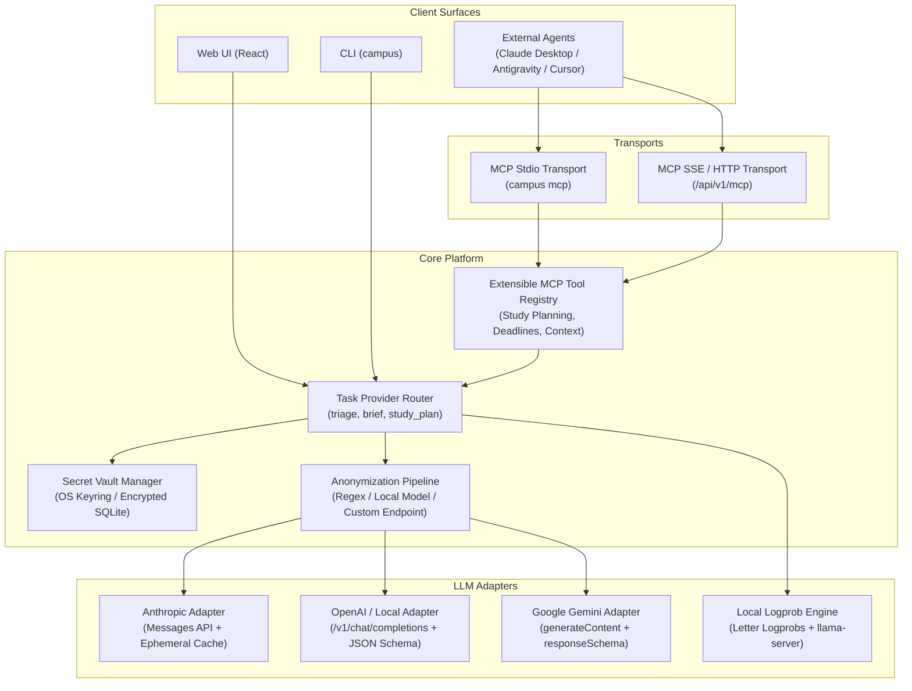

# LLM provider configuration, privacy, and MCP integration

> **Specification state.** Draft establishing multi-provider LLM adapters (Claude, OpenAI, Gemini, Local), encrypted secret storage and system keyrings, extensible Model Context Protocol (MCP) tool surfaces (stdio + SSE/HTTP) for study planning and interaction, and an anonymization pipeline for remote calls.

| Field | Value |
|---|---|
| ID | F-013 |
| Status | Draft |
| Owner | spiralsky |
| Created | 2026-10-27 |
| Last updated | 2026-10-27 |
| Target release | v1.0 |
| Related architecture | Canonical Item Taxonomy ([`F-002`](F-002-canonical-item-taxonomy.md)), Local API Contract ([`F-015`](F-015-local-api-contract-security.md)), Triage Cascade ([`F-006`](F-006-triage-cascade-workflow.md)), Task Briefs & Planning (`F-007`) |
| Supersedes | — |
| Superseded by | — |

**Source key.** `owner` = confirmed by product owner; `baseline` = observed in current implementation; `proposal` = proposed specification.

---

## 1. Summary

This specification governs the LLM inference layer, credential security, data privacy protections, and conversational Model Context Protocol (MCP) surface in `campus-assistant`. 

The system provides:
1. **Multi-Provider LLM Adapters:** First-class support for Anthropic Claude, OpenAI-compatible APIs (OpenAI GPT-4o/o1/o3, Ollama, LM Studio, vLLM, DeepSeek, Groq), Google Gemini API, and local in-process/llama.cpp logprob engines.
2. **Encrypted Secret & Key Management:** Secure storage of API keys with dual backend choices: OS-native Keyrings (Freedesktop Secret Service / macOS Keychain / Windows Credential Vault) or local Encrypted Database Vault (AES-256-GCM encrypted SQLite storage with PBKDF2/argon2 key derivation), selectable in settings with secure defaults.
3. **Dual-Transport Extensible MCP Server:** Native support for both **stdio** (for Claude Desktop, Antigravity, Cursor, and IDE extensions) and **SSE/Streamable HTTP** (for internal Web UI, local network agents, and browser clients). The server provides an extensible tool registry for reading academic contexts and mutating study schedules/timelines.
4. **Pluggable Anonymization Pipeline:** Pre-flight sanitization scrubbing student IDs, phone numbers, personal email addresses, and names before payloads leave `localhost`, with support for rule-based regex, custom local LLM redaction endpoints, or specialized local models.

---

## 2. Problem and context

`campus-assistant` relies on LLMs for core tasks like triaging campus communications, summarizing course announcements, and synthesizing multi-file task briefs with realistic study plans. 

However, users face several challenges with existing architectures:
* **Vendor Lock-in & Rigidity:** Hardcoding one or two cloud vendors limits users who prefer cost-effective options (e.g. DeepSeek, Groq), proprietary institutional endpoints, or purely local private stacks (Ollama/llama.cpp).
* **Cleartext Key Storage:** Storing sensitive cloud API keys in plain environment variables (`.env`) or plain SQLite tables risks token leakage to other processes or accidental source control check-ins.
* **Privacy Risks with Sensitive Academic Data:** Course announcements, feedback, and student emails contain student matriculation numbers, institutional usernames, phone numbers, and peer names. Sending raw student data to commercial cloud providers without redaction violates privacy norms and university IT policies.
* **Lack of Extensible Agentic Interfaces:** External AI agents (in IDEs or standalone chat interfaces) lack structured access to student deadlines, course briefs, and calendar slots, preventing them from assisting with real-time academic planning.

---

## 3. Users and jobs

| User | Job / need | Notes |
|---|---|---|
| Student (Privacy-Conscious) | Run full inbox triage and task planning without any sensitive academic records leaving the machine. | Uses local models (Ollama/vLLM) or enables the local anonymization layer before sending to cloud providers. |
| Student (Everyday User) | Use high-reasoning cloud models (Claude 3.7 Sonnet / GPT-4o / Gemini 2.0 Pro) for study timelines while keeping API keys securely protected. | Stores API credentials securely via OS Keyring or encrypted SQLite vault. |
| Power User / Developer | Connect IDEs or agentic interfaces (Antigravity, Cursor, Claude Desktop) to student schedules and task briefs via MCP. | Interacts via `campus mcp` (stdio) or `http://127.0.0.1:8000/mcp` (SSE). |

---

## 4. Goals and non-goals

**Goals**
- **G-1 (Broad Provider Compatibility):** Provide unified structured outputs (Pydantic validation) across Anthropic, OpenAI, Google Gemini, and local OpenAI-compatible engines.
- **G-2 (Secure Encrypted Credential Vault):** Default to OS Keyring when available; provide encrypted AES-256-GCM database storage with user-managed passphrase/key when keyring is headless or disabled.
- **G-3 (Configurable Anonymization Layer):** Provide pre-dispatch sanitization that masks identifiable entities (names, emails, IDs, phone numbers) before cloud egress. Support local regex masking or delegating sanitization to a local LLM endpoint.
- **G-4 (Extensible MCP Tool Registry):** Implement a declarative `@mcp_tool` registration interface supporting both stdio and HTTP/SSE transports, exposing study timeline generation, task context queries, and calendar mutations.
- **G-5 (Per-Task Granular Routing):** Allow users to independently assign different models and providers to different tasks (`triage`, `brief`, `study_plan`, `classify`).

**Non-goals**
- **NG-1 (Hosting Public Multi-User Endpoints):** The MCP server and API endpoints are strictly single-user and bound to localhost (`127.0.0.1` / `::1`).
- **NG-2 (Re-implementing LLM Serving):** The system does not package its own C++ LLM binaries; it interfaces with established local servers (llama-server, Ollama, LM Studio, vLLM).

---

## 5. Architecture and component design



---

## 6. Functional rules

### 6.1 Provider Adapters & Task Routing

| ID | Rule |
|---|---|
| **FR-013-01** | **Standardized Structured Output:** Every provider adapter MUST return parsed structured output validating against the requested Pydantic schema model. Fallbacks and schema repair MUST be applied if the provider returns invalid JSON. |
| **FR-013-02** | **Supported Driver Types:** The system MUST natively support: <br>1. `anthropic`: Anthropic Messages API (`claude-3-7-sonnet`, `claude-3-5-haiku`, etc.) with prompt caching. <br>2. `openai`: OpenAI API and compatible endpoints (`gpt-4o`, `gpt-4o-mini`, `o1`, `o3-mini`, DeepSeek, Groq, Together, OpenRouter) via `/v1/chat/completions` with JSON schema structured output. <br>3. `gemini`: Google Gemini API via `generateContent` with `responseSchema`. <br>4. `local`: Local OpenAI-compatible servers (llama.cpp `llama-server`, Ollama `/v1`, LM Studio, vLLM). |
| **FR-013-03** | **Per-Task Assignment:** Configuration MUST allow independent assignment of provider and model for: <br>- `triage`: Message categorization and extraction. <br>- `brief`: Task understanding and rubric parsing. <br>- `study_plan`: Multi-step milestone and study schedule creation. <br>- `classify`: Fast letter-logprob candidate filtering. |
| **FR-013-04** | **Thinking / Reasoning Controls:** Adapters MUST expose reasoning/thinking token controls (`thinking_budget` or `effort: low/medium/high`) where supported (e.g. Anthropic extended thinking, OpenAI reasoning effort, Qwen/DeepSeek thinking suppression). |

### 6.2 Credential Security & Encrypted Storage

| ID | Rule |
|---|---|
| **FR-013-05** | **Storage Modes:** Secret manager MUST support two secure backends: <br>1. `keyring` (default when supported): System OS Keyring (Freedesktop Secret Service / macOS Keychain / Windows Credential Manager). <br>2. `encrypted_db`: Local SQLite AES-256-GCM encryption with Argon2id / PBKDF2 key derivation using a user-specified vault passphrase or machine-unique hardware salt (`/etc/machine-id` + user GUID). |
| **FR-013-06** | **User Preference:** Users MUST be able to choose their storage backend in settings. If `keyring` is unavailable (e.g. headless Linux container/server), system MUST fall back gracefully to `encrypted_db` with an informative warning. |
| **FR-013-07** | **No Cleartext Keys:** Plaintext API keys MUST NEVER be written to regular SQLite tables, application logs, or REST API GET responses. |
| **FR-013-08** | **Environment Variable Precedence:** If an explicit environment variable exists (e.g. `ANTHROPIC_API_KEY`, `OPENAI_API_KEY`, `GEMINI_API_KEY`), it takes precedence over stored vault credentials for that execution session. |

### 6.3 Anonymization & Data Privacy

| ID | Rule |
|---|---|
| **FR-013-09** | **Privacy Boundaries:** If a task is set to `local`, no text payload may leave `127.0.0.1` under any circumstance. |
| **FR-013-10** | **Anonymization Pipeline:** When remote cloud providers are selected, the system MUST support an optional pre-flight sanitization pipeline that masks: <br>- Student ID / Matriculation numbers (e.g. `[STUDENT_ID_1]`) <br>- Personal and institution email addresses (`[EMAIL_1]`) <br>- Phone numbers (`[PHONE_1]`) <br>- Configured user names and nicknames (`[STUDENT_NAME]`) |
| **FR-013-11** | **Pluggable Anonymizer Backends:** The anonymization layer MUST be configurable as: <br>1. `regex`: Fast local rule-based token replacer (deterministic, zero-overhead). <br>2. `local_endpoint`: HTTP request to a local redaction microservice or local model (e.g. Ollama/llama.cpp running a NER / PII scrubbing model). <br>3. `off`: Direct egress without masking (explicit user consent required). |
| **FR-013-12** | **Consistent Re-identification Mapping:** The anonymizer MUST maintain a deterministic bidirectional session mapping so that entities extracted from the model (e.g. deadline for a specific lecturer or course link) can be restored into their real values when committed to the database. |

### 6.4 Model Context Protocol (MCP) Integration

| ID | Rule |
|---|---|
| **FR-013-13** | **Dual Transport Support:** The MCP server MUST support both: <br>1. **stdio transport** (`campus mcp`): Standard input/output for CLI/IDE clients (Claude Desktop, Antigravity, Cursor). <br>2. **Streamable HTTP / SSE transport** (`GET /api/v1/mcp/sse` + `POST /api/v1/mcp/messages`): For browser-based tools, web clients, and background processes. |
| **FR-013-14** | **Extensible Tool Registry:** Tools MUST be defined via a declarative registry (e.g. `@tool_registry.register`) with typed JSON schemas and docstrings, allowing new modules to add tools without altering server core code. |
| **FR-013-15** | **Core Academic & Study Planning Tools:** The MCP tool registry MUST provide at minimum: <br>- `list_upcoming_tasks`: Query assignments, quizzes, deadlines within a time horizon. <br>- `get_task_brief`: Retrieve synthesized summary, rubrics, and parsed requirements for an assignment. <br>- `get_course_materials`: Query content and extracted text from syllabus, lecture notes, or assignment attachments. <br>- `get_student_schedule`: Check calendar commitments and existing milestone blocks. <br>- `generate_study_timeline`: Propose concrete milestone steps and target dates before a deadline. <br>- `save_study_plan`: Persist study plan milestones to the database and sync with calendar feeds. <br>- `add_calendar_milestone`: Insert planning sessions directly into student calendar feeds. |
| **FR-013-16** | **Loopback & Auth Isolation for MCP:** HTTP/SSE MCP endpoints MUST bind strictly to `127.0.0.1` and require local bearer token verification or Host/Origin validation as defined in [`F-015`](F-015-local-api-contract-security.md). |

---

## 7. Data and contracts

### 7.1 Provider Configuration Schema (`meta` table key `config:llm`)

```json
{
  "secret_storage_mode": "keyring",
  "anonymization": {
    "enabled": true,
    "mode": "regex",
    "local_endpoint": null,
    "custom_terms": ["John Doe", "p2345678"]
  },
  "providers": {
    "claude": {
      "type": "anthropic",
      "model": "claude-3-7-sonnet-20250219",
      "thinking": true,
      "thinking_budget": 2048,
      "max_input_chars": 400000
    },
    "gemini": {
      "type": "gemini",
      "model": "gemini-2.0-flash",
      "max_input_chars": 800000
    },
    "openai_cloud": {
      "type": "openai",
      "base_url": "https://api.openai.com/v1",
      "model": "gpt-4o",
      "max_input_chars": 120000
    },
    "deepseek": {
      "type": "openai",
      "base_url": "https://api.deepseek.com/v1",
      "model": "deepseek-chat",
      "max_input_chars": 64000
    },
    "local_llama": {
      "type": "local",
      "base_url": "http://127.0.0.1:8080/v1",
      "model": "",
      "max_input_chars": 16000
    }
  },
  "tasks": {
    "classify": { "provider": "local_llama", "model": null },
    "triage": { "provider": "local_llama", "model": null },
    "brief": { "provider": "claude", "model": null },
    "study_plan": { "provider": "claude", "model": null }
  }
}
```

### 7.2 MCP Tool Interfaces

#### `generate_study_timeline`
* **Input Schema:**
```json
{
  "type": "object",
  "properties": {
    "task_id": { "type": "string", "description": "Canonical item ID of the assignment or project" },
    "available_daily_hours": { "type": "number", "description": "Target daily study hours", "default": 2.0 },
    "preferred_buffer_days": { "type": "integer", "description": "Buffer days before final deadline", "default": 2 }
  },
  "required": ["task_id"]
}
```
* **Output Schema:**
```json
{
  "task_id": "brightspace:assignment:987654",
  "total_estimated_hours": 12.5,
  "milestones": [
    {
      "step_number": 1,
      "title": "Literature review and dataset acquisition",
      "target_date": "2026-11-02T18:00:00+08:00",
      "estimated_hours": 3.0,
      "deliverables": "Downloaded CSVs and exploratory Jupyter notebook"
    },
    {
      "step_number": 2,
      "title": "Baseline model implementation and evaluation",
      "target_date": "2026-11-06T18:00:00+08:00",
      "estimated_hours": 5.0,
      "deliverables": "Trained baseline classifier and validation metrics"
    },
    {
      "step_number": 3,
      "title": "Final report write-up and rubric review",
      "target_date": "2026-11-09T18:00:00+08:00",
      "estimated_hours": 4.5,
      "deliverables": "PDF submission document adhering to grading criteria"
    }
  ]
}
```

#### `save_study_plan`
* **Input Schema:** Commits milestone steps into `analyses` (task: `brief`) and registers scheduled alarms into the database.
* **Output Schema:** `{ "task_id": "...", "status": "saved", "milestones_count": 3, "calendar_synced": true }`.

---

## 8. REST & MCP API Surface

| Protocol | Route / Command | Payload | Response | Description |
|---|---|---|---|---|
| CLI | `campus mcp` | stdio stream | stdio stream | Spawns standard MCP stdio JSON-RPC server. |
| HTTP | `GET /api/v1/mcp/sse` | — | SSE event stream | Establishes streamable SSE connection for MCP clients. |
| HTTP | `POST /api/v1/mcp/messages` | JSON-RPC 2.0 payload | JSON-RPC 2.0 response | Dispatches MCP tool calls or protocol queries over HTTP. |
| HTTP | `GET /api/v1/settings/llm` | — | `{ "data": LLMConfigResponse }` | Reads active provider settings, secret storage mode, and health probes (keys masked). |
| HTTP | `PUT /api/v1/settings/llm` | `{ "config": ... }` | `{ "data": { "status": "updated" } }` | Updates provider assignments, models, and privacy settings. |
| HTTP | `POST /api/v1/settings/llm/keys` | `{ "provider": "claude", "api_key": "sk-ant-..." }` | `{ "data": { "stored": true, "mode": "keyring" } }` | Securely commits API key to vault without plain logging. |
| HTTP | `POST /api/v1/settings/llm/probe` | `{ "type": "gemini", "api_key": "..." }` | `{ "data": { "reachable": true, "models": [...] } }` | Probes connectivity and lists available models for an endpoint. |

---

## 9. Edge cases and failure modes

| Case | Expected Behaviour |
|---|---|
| **Headless Environment (No Keyring Daemon)** | Keyring initialization detects absence of D-Bus secret service; automatically switches to `encrypted_db` mode, notifying the user. |
| **Corrupted Vault Key / Passphrase** | Decryption failure raises `VaultDecryptionError`. UI prompts user to re-enter master passphrase or re-authenticate API keys. |
| **Anonymizer Endpoint Down** | If configured to use local model/endpoint for PII scrubbing and that endpoint is unreachable, pipeline MUST halt remote call rather than fail-open, logging `PrivacyEgressBlockedError`. |
| **Provider Output Truncation (`max_tokens`)** | Adapters detect finish reason `length`; returns clean error prompting to allocate a larger token budget or summarize input context. |
| **Concurrent MCP Tool Mutations** | Calendar and task mutations execute inside SQLite transactions with immediate locks, preventing conflicting double-booking. |

---

## 10. UX and accessibility

- **Provider Health Indicators:** Visual green/red badges indicating whether credentials are saved and endpoints respond to health probes.
- **Privacy Shield Indicator:** An unmistakable badge in the UI displaying current egress status (`Local Only`, `Sanitized Cloud`, or `Direct Cloud`).
- **One-Click Test / Probe:** Ability to test any custom endpoint or API key with an immediate `Probe` button before saving.
- **Masked Password Inputs:** Keys are entered into password fields with toggleable visibility, never displayed in cleartext once saved.

---

## 11. Non-functional requirements

| Area | Requirement |
|---|---|
| **Security & Cryptography** | Encrypted DB mode MUST use AES-256-GCM with authenticated tags and Argon2id / PBKDF2 (minimum 100,000 iterations). |
| **Zero Memory Leakage of Keys** | In-memory API keys are scoped to provider instances and scrubbed upon process termination. |
| **MCP Protocol Conformance** | Compliant with official Model Context Protocol (MCP) specification 2024-11-05 (tools, resources, and prompts). |
| **Performance Overhead** | Regex anonymization layer overhead < 5ms per message. MCP tool dispatch overhead < 10ms. |

---

## 12. Acceptance criteria

| ID | Given | When | Then | Test level |
|---|---|---|---|---|
| **AC-013-01** | User enters an Anthropic API key in Settings. | Save is submitted with storage mode `keyring`. | Key is securely written to OS keyring, masked in subsequent reads, and validated via probe. | Integration |
| **AC-013-02** | System runs in headless environment without D-Bus secret service. | Secret vault initializes. | System automatically falls back to `encrypted_db` mode and logs warning. | Unit |
| **AC-013-03** | Anonymizer is enabled with mode `regex`. | A prompt containing student matriculation number and phone is sent to Claude. | The outgoing HTTP request payload contains masked tokens (`[STUDENT_ID_1]`), and response is re-mapped locally. | Integration |
| **AC-013-04** | An external MCP client runs `campus mcp`. | Client sends `tools/list` request over stdio. | Server returns available academic tools including `list_upcoming_tasks` and `generate_study_timeline`. | Integration |
| **AC-013-05** | External agent calls `generate_study_timeline` via MCP SSE transport. | Valid `task_id` is passed. | Server computes milestone schedule respecting due date and returns structured plan. | Integration |

---

## 13. Test plan

- **Unit Tests:**
  - Test secret manager across mock keyring and encrypted SQLite backends.
  - Test regex anonymizer token masking and bidirectional restoration.
  - Test Pydantic schema generation for OpenAI, Claude, and Gemini adapters.
- **Integration Tests:**
  - Test MCP server stdio protocol loop using standard JSON-RPC fixtures.
  - Test MCP server SSE endpoint connection and tool invocation.
  - Test provider probe and error handling with mock HTTP server.
- **Manual / E2E Tests:**
  - Add `campus mcp` to Claude Desktop configuration file and prompt Claude Desktop to generate a study plan for an upcoming course deadline.

---

## 14. Open questions and decisions

| ID | Question | Owner | Resolution | Date |
|---|---|---|---|---|
| **Q-013-01** | Which encryption library should be used for `encrypted_db` backend? | spiralsky | Use `cryptography` package (Fernet / AES-256-GCM), which is standard and audited in Python ecosystem. | 2026-10-27 |
| **Q-013-02** | Should the MCP server support Resources and Prompts in addition to Tools? | spiralsky | Yes, future iterations can expose course files as MCP Resources (`campus://courses/{id}/files/{name}`). Tools are the priority for v1.0. | 2026-10-27 |

---

## 15. Change log

| Date | Change | By |
|---|---|---|
| 2026-10-27 | Initial comprehensive specification draft for F-013 covering multi-provider adapters, encrypted vaults, dual-transport MCP, and anonymization layer. | spiralsky |
