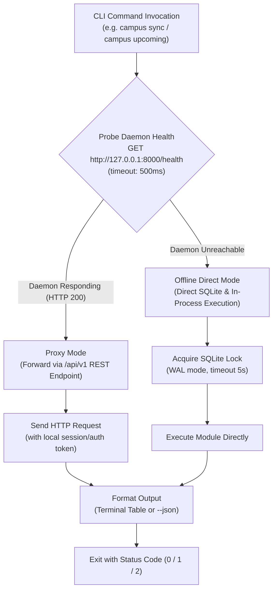

# CLI and background service operations

> **Specification state.** Draft establishing command-line interface dispatching (`campus`), dual-mode execution (HTTP daemon proxying vs offline in-process fallback), systemd user service management, process lifecycle, signal handling, and logging.

| Field | Value |
|---|---|
| ID | F-016 |
| Status | Draft |
| Owner | spiralsky |
| Created | 2026-10-27 |
| Last updated | 2026-10-27 |
| Target release | v1.0 |
| Related architecture | Product Scope ([`F-001`](F-001-product-scope-surfaces.md)), Local API Contract ([`F-015`](F-015-local-api-contract-security.md)), Standalone Crawler ([`F-019`](F-019-brightspace-crawler.md)), LLM Provider & MCP ([`F-013`](F-013-llm-provider-privacy-mcp.md)) |
| Supersedes | — |
| Superseded by | — |

**Source key.** `owner` = confirmed by product owner; `baseline` = observed in current implementation; `proposal` = proposed specification.

---

## 1. Summary

This specification governs the command-line interface (`campus`), process management, daemon supervision, and operational lifecycle of `campus-assistant`.

`campus-assistant` operates under a **hybrid execution model**:
1. When the background daemon (`campus serve`) is running under systemd or user supervision, ad-hoc CLI commands automatically detect the active service and proxy requests over the local REST API (`/api/v1`). This prevents lock contention on SQLite databases, preserves Playwright browser session state, and ensures background schedulers remain synchronized.
2. When the background daemon is not running, CLI commands fall back cleanly to direct in-process execution, acquiring necessary SQLite locks and running tasks locally without requiring a daemon startup.

Additionally, this specification formalizes the `campus service` management commands (`install`, `uninstall`, `restart`, `status`, `logs`), cgroup resource boundaries, graceful termination signal handling (`SIGTERM`/`SIGINT`), and structured JSON output for UNIX scripting.

---

## 2. Problem and context

The initial implementation of `cli.py` and `service.py` provided basic command routing and systemd unit installation, but suffered from operational edge cases:
* **Resource Clashes:** Running `campus sync` in a terminal while the background daemon was executing a scheduled sync could lead to database lock errors or Chromium profile locking conflicts.
* **Hardcoded Unit Text:** The systemd unit file was hardcoded to specific repo directories and python binaries rather than resolving active virtualenv or package entrypoints properly.
* **Inconsistent Output Formats:** CLI commands output a mix of unstructured print statements, JSON dictionaries, and traceback errors, making it difficult for users to compose scripts or inspect errors programmatically.
* **Headless Diagnostic Visibility:** Inspecting logs or service health required knowing underlying systemd commands rather than having a cohesive CLI diagnostics surface.

`F-016` establishes deterministic operational rules for command execution, daemon proxying, exit codes, and service orchestration.

---

## 3. Users and jobs

| User | Job / need | Notes |
|---|---|---|
| Student | Run quick terminal commands to check deadlines (`campus upcoming`) or trigger a sync (`campus sync`). | Needs instant output without waiting for background loops or getting database locked errors. |
| Power User / Sysadmin | Manage the background service lifecycle (`campus service install|restart|logs`). | Needs clean systemd user service integration with automated startup on user login. |
| External AI Agent (MCP / Script) | Execute CLI operations headlessly with machine-readable outputs. | Uses `--json` flag to receive structured envelopes with standard exit codes. |

---

## 4. Goals and non-goals

**Goals**
- **G-1 (Dual-Mode Execution):** Transparently proxy commands via HTTP when the local daemon is active; execute in-process when the daemon is stopped.
- **G-2 (Safe Concurrency & Profile Isolation):** Eliminate browser profile locking and SQLite busy timeouts by guaranteeing single-writer coordination through the running daemon.
- **G-3 (Native Service Management):** Provide turn-key Linux `systemd --user` unit installation, uninstallation, status inspection, and journal log streaming (`campus service logs -f`).
- **G-4 (UNIX Composability):** Standardize all informational commands with a `--json` flag, adhering to standard UNIX exit codes ($0$ for success, $1$ for logical error, $2$ for argument/command failure).
- **G-5 (Graceful Shutdown & Cleanup):** Handle `SIGTERM` and `SIGINT` cleanly, ensuring pending database transactions commit, temporary browser instances terminate, and locks release within a 15-second grace window.

**Non-goals**
- **NG-1 (Root / System-Wide Service):** `campus-assistant` runs strictly as a per-user daemon (`systemd --user`). It will not install into system-wide `/etc/systemd/system` or require `sudo` privileges.
- **NG-2 (Daemon Clustering / Multi-Node Orchestration):** No Kubernetes, Docker Swarm, or multi-node clustering; the service manages a single local process group.

---

## 5. Architectural model and command dispatching



---

## 6. Functional rules

### 6.1 Command Dispatching and Proxying

| ID | Rule |
|---|---|
| **FR-016-01** | **Active Daemon Detection:** Prior to executing stateful operations (`sync`, `login`, `import-mail`, `analyze`), the CLI MUST probe `GET {base_url}/health` with a 500ms timeout. |
| **FR-016-02** | **Proxying Precedence:** If the daemon answers with HTTP 200, the CLI MUST proxy the command to the daemon's REST API endpoint rather than running the task in-process. |
| **FR-016-03** | **Offline Fallback:** If the daemon is unreachable, the CLI MUST fall back to direct in-process execution, acquiring a direct connection to the SQLite database. |
| **FR-016-04** | **Standard Exit Codes:** CLI commands MUST exit with: <br>- `0`: Success / operation completed without error. <br>- `1`: Runtime or operational failure (e.g. login expired, sync error, LLM refused). <br>- `2`: CLI usage error (invalid flag, missing required argument). |
| **FR-016-05** | **JSON Output Flag:** Every data/status command (`upcoming`, `status`, `eval`, `analyze`, `sync`) MUST support a `--json` flag that outputs strictly valid JSON to stdout without terminal styling, warnings, or banner text. |

### 6.2 Service Lifecycle and Systemd Integration

| ID | Rule |
|---|---|
| **FR-016-06** | **Unit Location:** On Linux systems, `campus service install` MUST write the user unit file to `$XDG_CONFIG_HOME/systemd/user/campus-assistant.service` (default `~/.config/systemd/user/campus-assistant.service`). |
| **FR-016-07** | **Process Group Sandboxing:** The systemd unit MUST specify `KillMode=control-group` and `TasksMax=256` to ensure that child processes (such as Playwright Chromium instances) are cleanly terminated when the service stops. |
| **FR-016-08** | **Auto-Restart Policy:** The service unit MUST configure `Restart=on-failure`, `RestartSec=15`, and burst limits `StartLimitBurst=5` within `StartLimitIntervalSec=120` to prevent rapid failure loops. |
| **FR-016-09** | **Web UI Build Verification:** `campus serve` and `campus service install` MUST check whether Web UI production build assets exist (`web/dist/index.html`). If missing, they MUST print clear setup instructions (`./setup.sh` or `npm run build`). |

### 6.3 Signal Handling and Shutdown

| ID | Rule |
|---|---|
| **FR-016-10** | **Graceful Shutdown Window:** Upon receiving `SIGTERM` or `SIGINT`, the daemon MUST stop accepting new incoming requests, finish active in-flight sync or analysis jobs (up to a 15-second timeout), and flush database WAL locks before exiting. |
| **FR-016-11** | **Stale PID / Port Recovery:** If `campus serve` starts and finds port 8000 occupied by a dead or unresponsive process, it MUST check whether the process is an orphaned `campus-assistant` instance and report clear recovery commands to the user. |

---

## 7. Command reference

```text
campus [-v|--verbose] <command> [options]

Core Commands:
  serve                 Run the local HTTP REST API, Web UI, and background schedulers
  upcoming [--days N]   List upcoming assignments, quizzes, and deadlines
  sync [hosts...]       Trigger an immediate academic crawl and sync
  login [hosts...]      Open authentication window to sign into institutional portals
  check                 Check validity of existing portal sessions without crawling
  import-mail [path]    Import emails from local archive directory or .eml files
  analyze               Execute LLM triage of messages and task briefs
  eval [--cutoff P]     Compute classifier accuracy and calibration against human labels
  mcp                   Spawn Model Context Protocol (MCP) stdio JSON-RPC server

Operations & Service:
  service install       Install and enable systemd user service (starts on login)
  service uninstall     Stop and remove systemd user service
  service restart       Restart running background systemd user service
  service status        Display systemd service status, uptime, and cgroup memory
  service logs [-f]     View or follow journalctl logs for campus-assistant
```

### 7.1 Detailed Command Specifications

#### `campus serve`
* **Purpose:** Runs the FastAPI web server hosting `/api/v1`, static Web UI assets, and background sync/analysis worker tasks.
* **Flags:**
  * `--host <addr>`: Bind address (default: `127.0.0.1`).
  * `--port <port>`: Port number (default: `8000`).
  * `--no-schedule`: Disables background periodic sync intervals.
* **Exit:** Runs indefinitely until `SIGINT` / `SIGTERM`. Exits `1` if already running.

#### `campus upcoming`
* **Purpose:** Queries upcoming assignments, quizzes, and milestone steps.
* **Flags:**
  * `--days <n>`: Horizon window in days (default: `21`).
  * `--json`: Output as structured JSON array conforming to `Task` schema.
* **Output:**
```text
Mon 02 Nov 23:59  assignment  ST1522 CA2 Report (25%)  — Deep Learning
Wed 04 Nov 14:00  quiz        ST0251 Quiz 3            — Big Data
Fri 06 Nov 18:00  milestone   [Milestone] Draft Intro  — Deep Learning
```

#### `campus service logs`
* **Purpose:** Streams operational logs directly from Linux journald.
* **Flags:**
  * `-f`, `--follow`: Continuously follow log stream.
  * `-n`, `--lines <count>`: Number of recent log lines to display (default: `100`).
* **Implementation:** Transparently delegates via `os.execvp("journalctl", ...)` avoiding subshell buffering.

---

## 8. Service unit definition

The generated user unit file conforms to modern systemd standards:

```ini
[Unit]
Description=Campus Assistant (Academic Workstation Daemon)
Documentation=https://github.com/spiralsky/personal-app
PartOf=graphical-session.target
After=network.target graphical-session.target
StartLimitIntervalSec=120
StartLimitBurst=5

[Service]
Type=simple
ExecStart=%h/.local/bin/campus serve
WorkingDirectory=%h
Environment=PYTHONUNBUFFERED=1
Restart=on-failure
RestartSec=15
KillMode=control-group
TimeoutStopSec=15
TasksMax=256
MemoryAccounting=yes
CPUAccounting=yes

[Install]
WantedBy=graphical-session.target
```

---

## 9. Edge cases and failure modes

| Case | Expected Behaviour |
|---|---|
| **Daemon Crashes During Active Crawl** | Next service restart invokes database integrity check; stale sync lock in `meta` table is reset after timeout; headless browser instances killed by cgroup cleanup. |
| **CLI Invoked While Daemon is Busy** | CLI displays message: `Server busy (sync in progress); request queued` or exits cleanly with status report. |
| **System Running Non-systemd (macOS / Alpine / WSL1)** | `campus service` informs the user that systemd user services are Linux-only; outputs recommended `launchd` plist (macOS) or crontab string. |
| **Corrupted Web UI Build** | If `web/dist` has missing files or parse errors, daemon serves helpful fallback HTML page directing user to run `./setup.sh` instead of crashing. |
| **Concurrent CLI Executions in Offline Mode** | SQLite WAL mode handles readers; writers wait up to 5 seconds before returning clean busy exception rather than crashing with unhandled traceback. |

---

## 10. Non-functional requirements

| Area | Requirement |
|---|---|
| **CLI Latency** | Command dispatch probe overhead < 15ms. `campus upcoming` executes and renders in < 50ms. |
| **Resource Limits** | Service cgroup capped at 256 threads/tasks and idle RAM < 90 MB. |
| **Log Management** | Standard output sent to journald; logs contain ISO timestamps, module names, and severity levels. Log rotation managed by system journald retention policies. |

---

## 11. Acceptance criteria

| ID | Given | When | Then | Test level |
|---|---|---|---|---|
| **AC-016-01** | `campus serve` is active on port 8000. | User runs `campus sync`. | CLI detects running daemon, issues `POST /api/v1/sync/run`, and prints server response. | Integration |
| **AC-016-02** | `campus serve` is NOT running. | User runs `campus upcoming --json`. | CLI executes directly against SQLite store, outputs valid JSON to stdout, and exits `0`. | Integration |
| **AC-016-03** | Linux environment with systemd. | User runs `campus service install`. | Unit file is written to user directory, `systemctl --user daemon-reload` runs, and service starts. | Integration |
| **AC-016-04** | Service is running. | `SIGTERM` is sent to daemon process. | Daemon finishes active transaction, shuts down HTTP listener, and exits within 15s with code 0. | Integration |

---

## 12. Test plan

- **Unit Tests:**
  - Verify CLI argument parsing for all subcommands and flag combinations.
  - Test health check probe logic with mock HTTP server.
  - Verify unit file generator produces correct paths and environment settings.
- **Integration Tests:**
  - Test proxy delegation when mock daemon server is running.
  - Test offline fallback execution when server is unreachable.
  - Verify `--json` outputs match Pydantic schemas.

---

## 13. Open questions and decisions

| ID | Question | Owner | Resolution | Date |
|---|---|---|---|---|
| **Q-016-01** | Should `campus service` support macOS `launchd`? | spiralsky | Yes, add `campus service install` launchd generation on `sys.platform == "darwin"` in v1.1. Focus on Linux `systemd` for v1.0. | 2026-10-27 |
| **Q-016-02** | How should CLI authenticate when RBAC is enabled? | spiralsky | CLI reads local machine secret token from `$XDG_DATA_HOME/campus-assistant/.daemon-token` created by the running daemon with `0600` permissions. | 2026-10-27 |

---

## 14. Change log

| Date | Change | By |
|---|---|---|
| 2026-10-27 | Initial comprehensive specification draft for F-016 covering dual-mode CLI execution, systemd user service lifecycle, cgroup sandboxing, and signal handling. | spiralsky |
